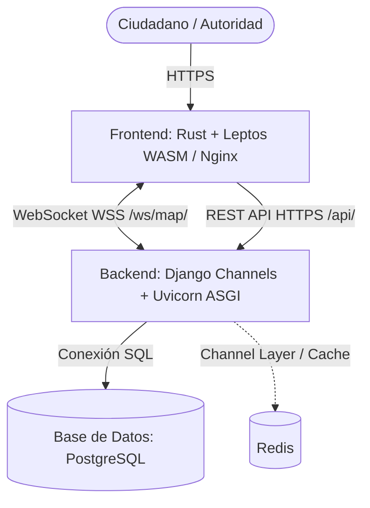

# EcoAlerta 🌱 - Plataforma de Monitoreo Ambiental (Cerro de Pasco)

EcoAlerta es una plataforma web de ciencia ciudadana y monitoreo en tiempo real diseñada para reportar, visualizar y gestionar incidentes ecológicos (contaminación minera, calidad del agua y aire, residuos sólidos) y puntos de acopio municipal en **Cerro de Pasco, Perú**.

Arquitectura moderna de alto rendimiento:
- **Backend**: Python 3.12, Django 5, Django REST Framework, Django Channels (ASGI con Uvicorn), PostgreSQL y Redis.
- **Frontend**: Rust (1.85+) compilado a **WebAssembly (WASM)** con el framework reactivo **Leptos**, renderizado estático/SPA servido con **Nginx** optimizado.
- **Despliegue**: Docker Multi-stage, Docker Compose y orquestación con **Coolify**.

---

## 🏛️ Arquitectura del Sistema



---

## 🚀 Ejecución Rápida con Docker Compose

La forma más rápida de levantar todo el ecosistema localmente (PostgreSQL, Redis, Backend Django y Frontend Rust WASM):

```bash
docker-compose up --build
```

- **Frontend WASM**: `http://localhost:8080`
- **Backend API**: `http://localhost:8000/api/`
- **Panel Administrativo Django**: `http://localhost:8000/admin/`

---

## 🛠️ Desarrollo Local

### 1. Backend (Python + Django ASGI)
```bash
cd backend
python -m venv venv
source venv/bin/activate # En Windows: venv\Scripts\activate
pip install -r requirements.txt
python manage.py migrate
python manage.py seed_waste_points --if-empty
python manage.py runserver
```

Para ejecutar la suite de pruebas unitarias:
```bash
python manage.py test alerts
```

### 2. Frontend (Rust + Leptos WebAssembly)
Requiere tener instalado Rust y Trunk:
```bash
rustup target add wasm32-unknown-unknown
cargo install --locked trunk
```

Para iniciar el servidor de desarrollo con autoreload y proxy hacia el backend:
```bash
cd frontend-wasm
trunk serve
```
La aplicación estará disponible en `http://localhost:8080`.

---

## 🌐 Despliegue en Producción (Coolify)

Para desplegar en un servidor VPS usando Coolify con certificados SSL automáticos (Let's Encrypt), consulta la guía detallada:
📖 **[COOLIFY_DEPLOY_GUIDE.md](COOLIFY_DEPLOY_GUIDE.md)**
